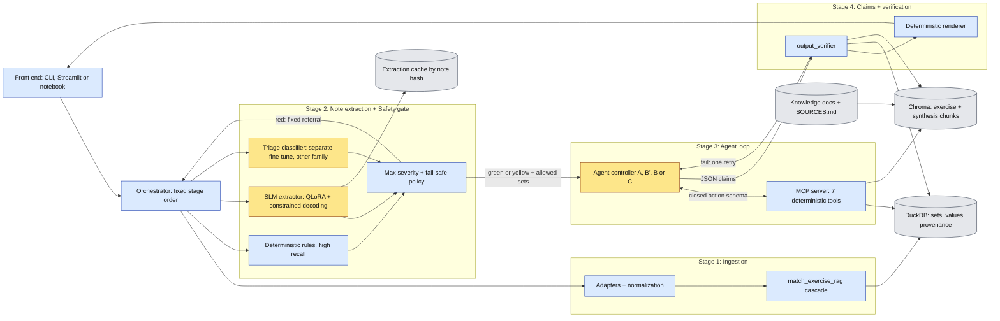
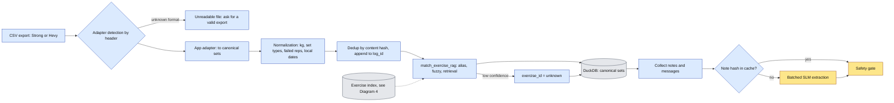
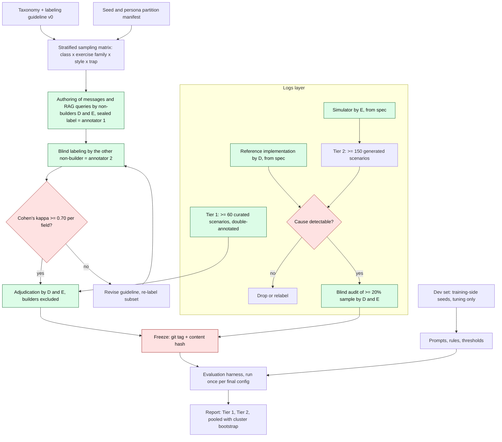
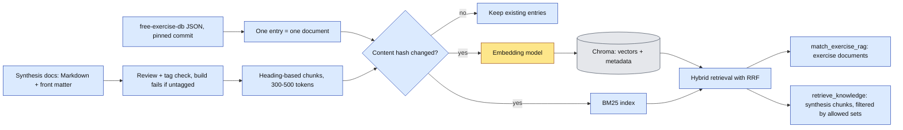
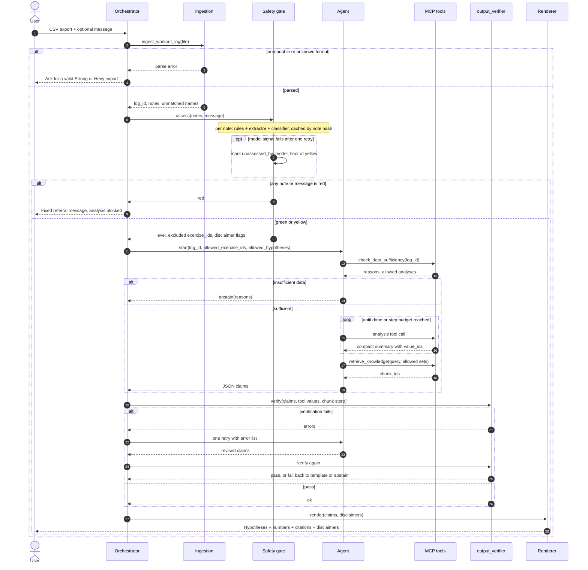
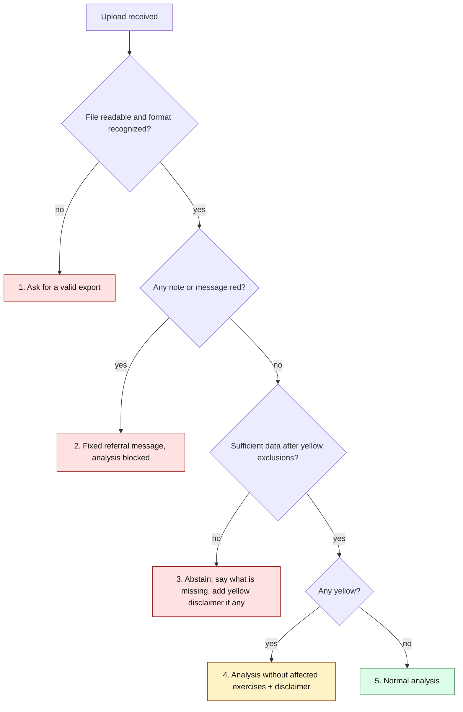
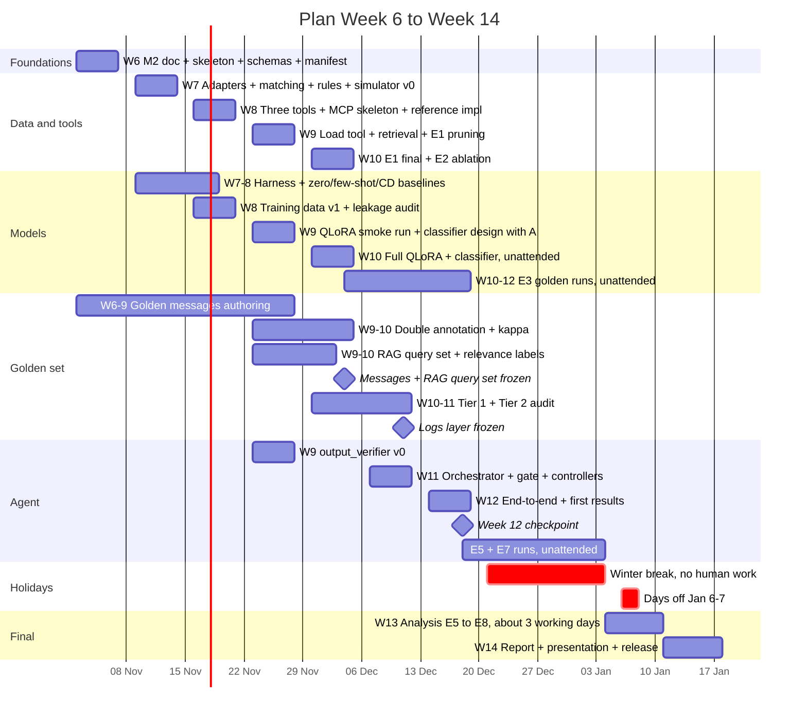

# Milestone 2: Architecture and Project Plan
## Heuristic Load & Fatigue Analyzer

**Team:** [team name] | **Members:** [Member A], [Member B], [Member C], [Member D], [Member E] | **Status:** Milestone 2, Week 6 (Nov 2-6, 2026)
**Baseline:** [`RFC_Heuristic_Load_Fatigue_Analyzer.md`](../RFC_Heuristic_Load_Fatigue_Analyzer.md) (Week 4 RFC). Departures from the RFC are listed in [Section 10](#10-changes-relative-to-the-rfc).

> **State of the repository.** At the time of writing the repository contains only the RFC and this document. **Nothing described below is built yet.** Every component, path and file name (`src/...`, `data/...`, `SOURCES.md`) is a design target. Markers used in this document:
> `[TO VERIFY]` is a fact we could not confirm from a primary source. `[TO MEASURE]` is a number that only an experiment can produce. `[SET]` is a threshold the team must fix before the final runs. `[CONFIRM with instructor]` is a question for the course staff.

---

## Contents

1. [Overview and scope](#1-overview-and-scope)
2. [Problem and data](#2-problem-and-data)
3. [Golden Dataset](#3-golden-dataset)
4. [RAG design](#4-rag-design)
5. [Agent, safety gate and tools (incl. MCP server)](#5-agent-safety-gate-and-tools-incl-mcp-server)
6. [Model choices](#6-model-choices)
7. [Evaluation and experiments](#7-evaluation-and-experiments)
8. [Plan: week by week to Week 14](#8-plan-week-by-week-to-week-14)
9. [Risks, scope cuts, open questions](#9-risks-scope-cuts-open-questions)
10. [Changes relative to the RFC](#10-changes-relative-to-the-rfc)

---

## 1. Overview and scope

### 1.1 How this document answers the assignment

| Assignment question | Answered in |
|---|---|
| **Problem and data:** What task will your system handle? | §1.3, §2.1 |
| Which dataset will you use? | §2.3 |
| How will it support ingesting new data? | §2.2 (logs, apps); §4.1 (knowledge) |
| **Golden Dataset:** How will you create a set of representative questions and expected answers for evaluation? | §3.1 (sampling matrix); examples in §3.3 (messages), §3.4 (logs), §3.6 (RAG queries) |
| **RAG design:** What chunking strategy, and why? | §4.1 |
| What embedding model, and why? | §4.2 |
| What vector database, and why? | §4.2 |
| What RAG approaches will you use or compare, and why? | §4.2-4.4; E1, E2 (§7) |
| **Agent and tools:** What decisions will the agent make? | §5.6, §5.9 |
| What tools will it use? | §5.7 |
| How will you expose those tools through an MCP server? | §5.7 (server and client side) |
| **Model choices:** Which SLM or other models, and what led you to choose them? | §6; embeddings and reranker §4.2 |
| **Plan:** Week-by-week timeline from now through the Week 14 final presentation, including the experiments | §8.1, Diagram 7; experiment weeks in §7 |
| Diagrams + explanation | Diagrams 1-7, each with a walkthrough |

Additional coverage: safety gate and failure precedence (§5.3-5.5); statistics (§3.5); risks and scope cuts (§9); changes relative to the RFC (§10).

### 1.2 Key design decisions

| Decision | Why |
|---|---|
| Tools compute every number (§5.7) | Small models make arithmetic errors; each number carries a checkable `value_id` |
| CSV parsed deterministically; the SLM reads only free-text notes (§2.2) | Set data is already structured; cost scales with notes, not sets |
| Mandatory gate before the agent: max severity of three signals; a failed model signal means at least yellow (§5.3) | Safety supersedes analysis; no note is silently skipped |
| Structured claims checked by ID (§5.8) | Verification is an exact lookup, not number-guessing in free text |
| Hybrid BM25 + dense retrieval in Chroma (§4) | Abbreviations defeat dense-only retrieval; metadata filters enforce the retrieval boundary |
| Action schema generated from the MCP tool list (§5.7) | The agent cannot call a missing tool or pass invalid arguments |
| Qwen3-1.7B + Llama-3.2-3B, QLoRA, Outlines; classifier from the other family (§6) | Two families within 1-3B that fit a 16 GB GPU; less correlated gate errors |
| Agent autonomy is an experiment (§5.9, E5) | 1-3B models may need rigid orchestration; the product does not depend on it |
| Golden data by non-builders, frozen before final runs (§3) | No tuning to the test set |
| Week 12 front-loaded; long jobs run over the break (§8) | Week 12 is the commit checkpoint; Week 13 has ~3 working days |

### 1.3 Task and scope

**Task.** The user uploads a strength-training log (a Strong or Hevy CSV export) and optionally a free-text message. The system returns **labeled hypotheses** explaining why the lifter may have plateaued. Each hypothesis has an evidence level and is backed by numbers that tools computed and by citations that exist in our knowledge base. When the data cannot support any hypothesis, the system abstains. A fine-tuned small language model (SLM, 1-3B parameters) extracts structured fields from free-text notes. An agent decides which analyses to run. **Numbers come from tools, never from the model.**

**Non-goals** (from the RFC, unchanged): no diet or nutrition advice, no medical diagnosis, no advice of any kind about pain or injury, no exercise recommendations for areas with reported discomfort, no form diagnosis from text, and no claim that the acute:chronic ratio predicts injury.

### 1.4 Architecture

A deterministic **orchestrator** runs four stages in a fixed order (Diagram 1):
1. ingestion into DuckDB;
2. note extraction and the safety gate;
3. the agent loop over seven MCP tools, restricted to what the gate allows;
4. claim verification and rendering.

The gate and the verifier belong to the orchestrator, not to the agent, so no code path can skip them.


*Diagram 1: components (`docs/diagrams/architecture-components.mmd`). Blue = deterministic, amber = model-driven, grey = storage.*

Only the extractor, the classifier and the agent are model-driven (amber). The agent reaches data only through the MCP tools, and the user sees its output only after `output_verifier`. A red result never reaches the agent.

---

## 2. Problem and data

### 2.1 Problem

Training apps store every set but explain nothing. A plateau, meaning a stagnant estimated one-rep max (e1RM) over several weeks, has many possible causes: too little volume, accumulated fatigue, a sudden load spike, irregular training, bad logging, or outside confounders such as sleep loss or illness. Generic LLMs answer such questions fluently, but they do arithmetic wrong and cite sources they cannot check. Our design principle: **the model chooses and explains; tools compute; the verifier checks; the gate protects.**

### 2.2 Input formats and ingestion

**Who parses what.**

| Input | Parsed by | Method |
|---|---|---|
| Structured set data (date, workout, exercise name, weight, reps, RPE, set type, distance/duration) | Ingestion adapters | **Deterministic** CSV parsing |
| Exercise names (free strings like "RDL", "Bench Press (Barbell)") | `match_exercise_rag` | Cascade: alias dictionary, then fuzzy matching, then retrieval. **Not the SLM.** |
| Free-text notes (per set or exercise, per workout) and free-text user messages | SLM extractor (inside the gate stage) | Closed-vocabulary extraction to strict JSON |

Notes are sparse (typically a handful per workout), so extraction cost scales with the number of notes, not the number of sets. The agent never parses raw logs. Its decisions concern the analysis itself; they are listed in §5.6.

**Column mappings.** Neither app publishes an official export schema that we could find. The mappings below come from community sources. **They will be confirmed against real, anonymized exports from team members in Week 6** and committed as fixtures together with the adapters. `[TO VERIFY against real exports]`

| Field (internal) | Strong CSV (community-reported header) | Hevy CSV (community-reported header) |
|---|---|---|
| workout timestamp | `Date` | `start_time` (`end_time` also present) |
| workout name | `Workout Name` | `title` |
| workout duration | `Duration` | derived from `start_time`, `end_time` |
| exercise name | `Exercise Name` | `exercise_title` |
| set index | `Set Order` | `set_index` |
| set type (warm-up/normal/failure/drop) | not a separate column; encoding in `Set Order` `[TO VERIFY]` | `set_type` (value set `[TO VERIFY]`) |
| weight | `Weight` (some exports `Weight (kg)`; unit depends on app settings `[TO VERIFY]`) | `weight_kg` or `weight_lbs` (unit in the column name) |
| reps | `Reps` | `reps` |
| RPE | `RPE` | `rpe` |
| distance / time | `Distance`, `Seconds` | `distance_km`/`distance_miles`, `duration_seconds` |
| exercise/set notes | `Notes` | `exercise_notes` |
| workout notes | `Workout Notes` | `description` |
| superset | n/a | `superset_id` |

Sources for the table: a Strong header quoted on the intervals.icu forum (<https://forum.intervals.icu/t/import-strong-data-weightlifting-app/5531>) and Hevy headers from community parsers. Hevy's help center documents the export path (Profile > Settings > Export & Import Data) but not the columns (<https://help.hevyapp.com/hc/en-us/articles/38001424401943>). We treat all of this as a hypothesis until real exports confirm it.

**Normalization rules (design).**
- **Units.** All loads are converted to kg internally. The source unit is kept per row. A log mixing units within one exercise is flagged as a numeric trap and becomes a test fixture.
- **Set types.** Warm-up sets are excluded from effective sets and e1RM. Failure and drop sets are kept and tagged. A set is "failed" if reps = 0 or it is marked as failed; failed sets are excluded from e1RM (RFC).
- **Dates.** Timestamps are parsed with an explicit per-adapter format. The lifter's local date is the analysis unit, so no timezone conversion happens (exports carry local time `[TO VERIFY]`). Ambiguous formats fail loudly and fall under precedence level 1.
- **Duplicates.** Each set row has a content hash over (workout timestamp, exercise, set index, weight, reps, RPE). Re-ingesting the same rows changes nothing.
- **Incremental ingestion.** A new export for the same user appends only unseen workouts to the existing `log_id` namespace. Ingestion is idempotent.
- **Adapter pattern.** `BaseAdapter.detect(header) -> bool` and `BaseAdapter.to_canonical(df) -> CanonicalSets`. A third app needs one new class plus fixtures; the downstream code does not change.
  - *Alternatives considered:*
    - **One generic parser driven by a per-app column-mapping file.** Less code, but app-specific semantics end up as special cases in configuration: Strong's set-type encoding, Hevy's unit in the column name, and Hevy's grouping of workouts by start and end time.
    - **Letting the SLM map columns or rows.** Rejected: it is non-deterministic and would break the rule that numbers come only from tools.
  - *Risk:* an app silently changes its export format. Mitigation: header detection fails loudly, and each adapter has fixture tests built from real exports.


*Diagram 2: ingestion pipeline (`docs/diagrams/ingestion-pipeline.mmd`). Blue = deterministic, amber = model-driven, grey = storage.*

The header selects the adapter; an unknown format stops here (precedence level 1). Deduplication by content hash makes re-uploads and new exports safe. Notes reach batched, cached extraction only after exercise matching.

### 2.3 Datasets

| ID | Dataset | Role | License / consent |
|---|---|---|---|
| (a) | **free-exercise-db** (`yuhonas/free-exercise-db`, 800+ exercises) | Closed `exercise_id` vocabulary; muscle mapping (`primaryMuscles`, `secondaryMuscles`, 17 muscle values); retrieval corpus for matching | **Unlicense** (public-domain dedication), verified on the repository page |
| (b) | Real logs from team members | Adapter fixtures, Tier 1 golden scenarios, real-note generalization probe | Own data, anonymized, written consent per member |
| (c) | **Synthetic lifter simulator** (code) | Tier 2 scenarios with seeded, known plateau causes; ground truth by construction | Ours |
| (d) | Synthetic messages (templated + LLM-paraphrased) | SLM training data for extraction and triage | Generator terms of use `[TO VERIFY]` (see below) |

free-exercise-db schema (from `schema.json`): `id`, `name`, `force`, `level`, `mechanic`, `equipment`, `primaryMuscles`, `secondaryMuscles`, `instructions`, `category`, `images`. `force`, `mechanic` and `equipment` may be `null`. The muscle enum is: abdominals, abductors, adductors, biceps, calves, chest, forearms, glutes, hamstrings, lats, lower back, middle back, neck, quadriceps, shoulders, traps, triceps.

### 2.4 Leakage prevention (strict)

Embedding or n-gram similarity checks are necessary but not sufficient. Training data generated from the same taxonomy and guideline as the golden data can leak structure and phrasing even when no single item is a near-duplicate. We apply six controls:

1. **Disjoint generation inputs.** Seeds, personas, scenario templates and phrasing families are partitioned into "training" and "golden" pools. The partition is recorded in a manifest (`data/manifests/partition.yaml`, Week 6) before any data is generated.
2. **Clean generator prompts.** Prompts never contain golden examples or the examples from the annotation guideline.
3. **Split by phrasing family.** Whole families are held out, not individual items.
4. **Human-written probe.** Real notes written by team members, which never passed through a generator, go into the golden set as a generalization probe.
5. **Near-duplicate check.** n-gram and embedding similarity of every training item against the golden set, run by a non-builder ([Member D]). D gives builders only the IDs of training items to drop, never golden text.
6. **Stylistic separation.**
   - Training messages are generated with several LLMs from different families, for style diversity.
   - Any LLM used to write or paraphrase notes for the golden set or for Tier 2 must come from a **different model family than every training generator**. Otherwise those notes are human-written or templated with no LLM.
   - The simulator is code, so Tier 2 CSVs carry no LLM style.
   - The manifest records generator model and version per item.
   - Whether each commercial provider's terms allow using outputs as fine-tuning data must be checked before use. `[TO VERIFY per provider]` `[CONFIRM with instructor: which LLMs may be used as generators]`

### 2.5 Data sufficiency (defines the abstention cases)

`check_data_sufficiency(log_id)` returns `{sufficient: bool, reasons: [...], allowed_analyses: [...]}`. Thresholds are configurable defaults. They are tuned on the dev set only and frozen before the golden logs layer is frozen.

| Check | Default | Rationale |
|---|---|---|
| History span | >= 5 weeks with data | `uncoupled_load_analyzer` needs a 7-day acute window plus a non-overlapping 21-28-day chronic window |
| Sessions per analyzed exercise | >= 4 sessions in the last 6 weeks, after excluding failed and warm-up sets | A trend needs more than two or three points |
| RPE coverage (for drift) | >= 50% of working sets carry RPE, and >= 4 sessions at comparable load (±5%) | RPE drift is defined only at comparable load |
| Gaps | No gap > 14 days inside the analyzed window | A gap resets the chronic window and confounds trends |
| Matched exercises | >= 1 analyzed exercise resolved with high confidence (not `unknown`) | Avoids analysis of guessed exercises |

Each failed check names what is missing. The response repeats it to the user, for example "RPE logged on 2 of 18 working sets; RPE drift not assessed". Abstention is partial when some analyses are allowed and others are not.


---

## 3. Golden Dataset

### 3.1 Process

The golden set is built in this order:
1. Write the taxonomy and the labeling guideline.
2. Build a stratified sampling matrix: class × exercise family × phrasing style × trap type.
3. Members who do not build or tune models author the items.
4. Two independent annotators label them.
5. Compute Cohen's kappa per field and overall.
6. Adjudicate disagreements.
7. **Freeze** the set: a git tag plus a SHA-256 content hash recorded in `data/golden/FREEZE.md`.
8. From then on, the set is used for evaluation only.

A separate **dev set**, drawn from the training-side seed pool, is used for all tuning (prompts, rule thresholds, sufficiency thresholds, the retry policy). It is never reported as a result. The RAG query set (§3.6) follows the same authoring, blind-labeling and freeze steps.

**Access control.** Golden test files live in a directory that builders agree not to open before the freeze. The freeze commit records the file hashes. Every evaluation run logs the hash of the files it read, and any golden read by a builder before the freeze is logged as a protocol deviation. This is an honor system backed by an audit trail, and we say so. The repository is shared, so we cannot enforce cryptographic separation without hurting the git-history requirement.

### 3.2 Annotation protocol for a five-person team

The two non-builders, [Member D] and [Member E], are both the golden authors and the two annotators.
- Each authors half of the items from the sampling matrix and **seals the intended label at authoring time**. This is annotator 1.
- The other non-builder then labels each item **blind to the intended class**. This is annotator 2.
- Kappa is computed between the sealed label and the blind label. It is also computed on a ≥ 20% subset that both label blind; a third party re-randomizes those items and strips the sealed labels.
- Disagreements are adjudicated by D and E together. Builders do not take part.

`[CONFIRM with instructor that sealed author label + blind second label satisfies "two independent annotators"]`

**Kappa threshold.** If kappa < 0.70 on any headline field, we revise the guideline and re-label the affected subset. Justification:
- 0.70 sits inside the 0.61-0.80 "substantial" band of Landis & Koch (1977, *Biometrics* 33(1):159-174).
- Our labels feed a safety metric, so "moderate" agreement (≤ 0.60) is not acceptable.
- We do not demand > 0.80 because yellow/red boundaries are inherently fuzzy.

For the red class we additionally require that **every** red-vs-not-red disagreement is adjudicated and logged, whatever the overall kappa.

### 3.3 Messages layer

- **≥ 250 held-out messages: 110 green / 60 yellow / 80 red** (RFC split), never used in training or tuning.
- **Hard negatives**, a dedicated stratum inside green and yellow:
  - figurative pain ("my quads were dying", "this set killed me")
  - negated pain ("no pain at all today")
  - yellow/red boundary cases
  - gym slang, typos and abbreviations
- **Real-note generalization probe.** Human-written notes from team members' real logs that never passed through a generator, reported as a separate slice.
- Each item is labeled with the full extraction schema (§6.3), not only the triage level, so the same layer serves E3 (extraction F1) and E4 (gate).

*Example item.* Input: "Bench 80 kg x 5 @8, last rep was a grind. Left shoulder a bit achy since Tuesday." Expected answer:
```json
{"exercise_id": "Barbell_Bench_Press_-_Medium_Grip", "kinematic_observation": "grinding_rep",
 "load": {"value": 80, "unit": "kg"}, "reps": 5, "outcome": "completed", "rpe": 8, "triage_level": "yellow"}
```
Gate effect: yellow; bench press is excluded and the disclaimer is shown.

### 3.4 Logs layer: two tiers

**Tier 1 (RFC minimum, fully double-annotated).** ≥ 60 hand-curated end-to-end scenarios built from (anonymized) real logs and hand edits:
- ≥ 20 abstention cases
- confounders (sleep loss, illness, travel)
- numeric traps (failed reps, unit mix, duplicate sets, outlier RPE)

Labels: the expected hypothesis labels with evidence levels, abstain yes/no with reasons, and the gate outcome.

**Tier 2 (added on top of the RFC, for statistical power).** ≥ 150 scenarios procedurally generated by the simulator, with ground truth by construction.
- **Stratified quotas** (overlaps allowed, total ≥ 150): ≥ 20 per hypothesis label, ≥ 30 abstention, ≥ 20 with confounders, ≥ 20 with numeric traps.
- **Expected numbers** (e1RM, weekly sets, acute/chronic load) come from an **independent reference implementation** written by a non-builder ([Member D]) from the written indicator specification, not from the tool code.
- **Detectability validation.** An injected cause must be recoverable by the stated heuristics, as checked with the reference implementation. Otherwise the label is not "true by construction", and the scenario is dropped or relabeled.
- **Audit.** Both annotators independently audit the same random ≥ 20% sample, blind to the simulator labels. We report agreement with ground truth and kappa on that sample.
- Free-text notes in Tier 2 are templated from **held-out phrasing families**.
- **Reporting.** Tier 1 and Tier 2 are reported **separately**, which shows the synthetic-to-real gap, and also pooled. Pooled numbers are never used alone for generalization claims, because Tier 2 items share simulator parameters and are not fully independent.

*Example item (Tier 2).* Ten weeks of `Barbell_Squat` three times a week. From week 5 the working sets stay at 120 kg × 5 while logged RPE rises from 7 to 9; there are no notes. Expected answer:
- hypotheses: `fatigue_accumulation` (supported) and `stagnant_load_progression` (supported);
- numbers: e1RM (Epley) flat at 140.0 kg; RPE drift ≈ +0.4 per week at constant load;
- `abstain: false`; gate outcome green.

**Limitation: heuristic coupling.**
- Tier 2 labels come from the same heuristics the tools implement (injected cause, therefore detectable by the indicators). Tier 2 therefore tests **correctness and consistency** of the pipeline: orchestration, abstention and verifier behavior.
- It does **not** validate that the heuristics identify real causes of plateau in real lifters. Validity claims rest on Tier 1, which is real-log-based and human-labeled, and are limited by its size.
- The SLM is never trained on log scenarios, so this is a concern about evaluation validity, not model overfitting.
- To reduce correlated errors, the **simulator ([Member E]) and the reference implementation ([Member D]) are written by two different non-builders**, each from the written specification, and then cross-reviewed. Discrepancies are resolved against the specification, and the specification is corrected if needed.

### 3.5 Statistics plan

| Quantity | Method |
|---|---|
| Red recall | Wilson 95% interval, reported whatever the result. With 80/80 the lower bound is 80/(80+1.96²) ≈ **0.954** |
| F1 (field-level, hypothesis-level) | Bootstrap 95% CI (≥ 2,000 resamples) |
| Variant A vs variant B | **Paired** comparison on the same items |
| Pooled or clustered sets | **Cluster bootstrap**, resampling whole clusters, or cluster-level permutation tests. Clusters are the simulator template/parameter family (Tier 2) and the source lifter (Tier 1). We report the number of clusters and an effective sample size. Any plain McNemar or paired-bootstrap p-value shown is labeled an approximation |
| Per-class results | Only where class N ≥ 10; otherwise pooled, and we say so |
| Multiple comparisons | The list of comparisons is **pre-registered** (committed before final runs); Holm correction |

**Power, stated honestly.** Paired tests on ~200 items detect only fairly large effects when discordant pairs are few. Example: with 20 discordant pairs, an exact two-sided McNemar test needs a 15-vs-5 split (p ≈ 0.041). A 14-vs-6 split gives p ≈ 0.115. So a net difference of 10 items, 5% of 200, is about the smallest effect we can call significant in that situation. We report effect sizes with CIs and do not over-claim significance.


*Diagram 3: golden dataset and evaluation pipeline (`docs/diagrams/golden-and-eval-pipeline.mmd`). Green = non-builder work, red = gates on the process.*

Messages, RAG queries and Tier 1 get a sealed label, a blind second label, kappa and adjudication. Tier 2 gets the detectability check and a blind audit. Everything is frozen before the harness runs it once.

### 3.6 RAG query set (held-out)

- **Content.** 60-100 queries: about two thirds on synthesis-document topics, one third exercise names (abbreviations, app spellings).
- **Authors and labels.** [Member D] and [Member E] each write half and label the relevant passages (sealed). The other labels a blind ≥ 20% subset, and agreement is reported. Builders never see the set; [Member C] tunes on ~20 dev queries of their own.
- **Chunking-independent labels.** Relevance is a `doc_id` + section + character span (or an `exercise_id`). A chunk is relevant if it overlaps a labeled span, so one label set scores every chunking variant.
- **Use.** Frozen with the messages layer at the end of Week 10; E1 reports recall@3/5 and MRR on it once.

*Example item* (illustrative IDs). Query: "Why is acute load reported separately from chronic load?" Expected answer: a span in `syn05`, section "Coupled and uncoupled ratios", which resolves to chunk `syn05#c02` under heading-based chunking.

---

## 4. RAG design

### 4.1 Corpora and chunking

| Corpus | Unit | Text indexed | Metadata |
|---|---|---|---|
| free-exercise-db | **One entry = one document, no splitting** | `name` + aliases from our alias dictionary + muscles + equipment + category + mechanic | `exercise_id`, `primaryMuscles`, `secondaryMuscles` |
| Synthesis docs (5-10, team-written) | **Heading-based chunks**, 300-500 tokens, ~50-token overlap | Section text | `doc_id`, `section`, `chunk_id`, `citation_keys[]`, `topic_tags[]`, `exercise_ids[]` |

Why these units:
- An exercise entry is short and self-contained (name, muscles, equipment), so splitting it would only separate the name from the muscles it maps to.
- Heading-based chunks follow the topic boundaries that citations point to, so one cited chunk covers one topic.

Synthesis documents cover **training variables only**: volume, intensity, RPE/RIR, fatigue management as load, load monitoring (including the ACWR controversy), and progression. No document covers pain or injury management. Builders draft them, LLM-assisted drafting allowed; a human verifies every citation against the source; non-builders review them. Each source and its license is listed in `SOURCES.md`. `[TO VERIFY each source's license as it is added]`

**Adding knowledge.**
- *New synthesis document:* Markdown with front matter (`doc_id`, `topic_tags`, citation keys). After review, the index build chunks it by heading, fails on untagged chunks, and embeds and BM25-indexes only chunks whose content hash changed. Chunk IDs (`doc_id#cNN`) stay stable while a document is unchanged.
- *free-exercise-db update:* pulled at a pinned commit and diffed by `id`. Changed entries are re-embedded; removed IDs stay resolvable for old logs but are never matched.
- Each build writes an index manifest (source commits, embedding model, chunk hashes).

**Chunking comparison (E1):** fixed 256 tokens, fixed 512, heading-based, and sentence-window. Metrics on the held-out RAG query set (§3.6): recall@k (k = 3, 5), MRR, and downstream citation validity. Free-exercise-db is not chunked, so the comparison applies to the synthesis corpus only.

### 4.2 Embeddings, vector store, retrieval

**Embedding candidates.** Licenses come from the model cards. e5-small-v2 was checked on its own Hugging Face card; the other three were confirmed through a third-party model directory and will be re-checked on their cards when pinned.

| Model | License | Notes |
|---|---|---|
| `sentence-transformers/all-MiniLM-L6-v2` | Apache-2.0 | Small general baseline |
| `BAAI/bge-small-en-v1.5` | MIT | Strong small retrieval model |
| `intfloat/e5-small-v2` | MIT | 384-dim, 33M params; requires `query: ` / `passage: ` prefixes |
| `nomic-ai/nomic-embed-text-v1.5` | Apache-2.0 | Larger, long context; needs task prefixes `[TO VERIFY exact prefixes]` |

We select by measured retrieval quality (E1), then size, then license. We do not choose by leaderboard. Risk: our retrieval query set is small, so E1 may not separate the candidates. The model that wins on synthesis chunks may also be weaker on short exercise-name queries. Mitigation: E1 scores the two corpora separately, ties go to the smaller model, and re-embedding corpora this small is cheap, so the choice stays reversible.

**Vector DB.** Comparison criteria: setup cost, metadata filtering, persistence.
- **Chroma** (default): embedded, persistent on disk, `where` filters on metadata, enough for < 10k chunks.
- **Qdrant** (local): stronger filtering and payload indexing, but one more service.
- **FAISS**: fastest, but no native metadata filtering or persistence layer. We would rebuild what Chroma gives for free.

The retrieval boundary (§5.4) depends on metadata filters, which rules out plain FAISS. Qdrant is a scope-cut candidate. Main risk: Chroma API churn between versions. Mitigation: pin the version and wrap it behind a 2-method interface.

**Retrieval approaches** (E1):
1. Dense only.
2. **Hybrid BM25 + dense with reciprocal rank fusion (RRF)**.
3. Hybrid + cross-encoder reranker. Tentative candidate: `cross-encoder/ms-marco-MiniLM-L6-v2` (Apache-2.0 per its model card), chosen for its small size (~23M parameters). It is trained on MS MARCO, whose data terms for our use are `[TO VERIFY]`.

The default is (2). Lifting vocabulary is full of abbreviations and exact tokens ("RDL", "OHP", "SSB") that dense models handle poorly and BM25 handles well. Risk: RRF fuses ranks, not scores, so a confident BM25 hit can be diluted by unrelated dense hits. Hybrid retrieval also means two indexes that must stay in sync. Mitigation: the alias stage resolves known abbreviations before retrieval, one build script rebuilds both indexes from the same chunk table, and E1 keeps dense-only as a baseline, so hybrid has to earn its place.


*Diagram 4: RAG pipeline (`docs/diagrams/rag-pipeline.mmd`). Blue = deterministic, amber = model-driven, grey = storage.*

Both corpora share one incremental build that re-embeds only changed content. Queries hit the dense and BM25 indexes, and RRF fuses the rankings. `retrieve_knowledge` is additionally filtered by the gate's allowed sets.

### 4.3 `match_exercise_rag` cascade

1. **Alias dictionary.** A hand-curated mapping from app strings to `exercise_id` (e.g. "RDL" → `Romanian_Deadlift`), seeded from the names in team members' exports.
2. **Fuzzy matching** on normalized names (token-set ratio), with a threshold tuned on dev.
3. **Retrieval** over free-exercise-db documents (hybrid), top-k candidates plus score.
4. **Low confidence → `unknown`**, never a guess. Unknown exercises are excluded from analysis and reported to the user.

Each stage records which stage matched, so E2 can attribute errors.

### 4.4 RAG ablation (RFC requirement, E2)

"Without RAG" means the model receives the closed `exercise_id` vocabulary **only** as a constrained-decoding enum or an in-prompt list, with no retrieved candidates and no knowledge chunks. "With RAG" adds the cascade candidates and retrieved chunks. Metrics: `exercise_id` accuracy (on messages and on names in logs) and citation validity (existence and allowed-set membership). The deterministic cascade stages 1-2 are reported both inside and outside the ablation, so the RAG contribution is not inflated by the alias dictionary.

---

## 5. Agent, safety gate and tools (incl. MCP server)

### 5.1 Components

Diagram 1 (§1.4) shows all components. This section details the parts that carry the safety and verification design.

### 5.2 Request sequence


*Diagram 5: request sequence (`docs/diagrams/request-sequence.mmd`).*

The nested `alt` blocks follow the precedence order: unreadable file, red, insufficient data. The `opt` block is the fail-safe path (failed model signal → yellow). The verifier allows one retry, then a template answer or abstention.

### 5.3 Safety gate

**Choice.** A mandatory gate runs before the agent and is structurally unbypassable. It combines three signals per note: deterministic rules, a separately trained SLM triage classifier, and the extractor's `triage_level`. The combination is the **maximum severity**, first per note, then per log.

Alternatives considered:
- *Gate as an agent tool.* Rejected: the agent could skip it.
- *A single classifier.* Rejected: a single point of failure, and the RFC asks for three signals.
- *Majority vote.* Rejected: it lets two weak "green" signals overrule a correct "red".

**Placement of extraction.** The extractor call lives inside the gate stage because the RFC's third signal is the extracted `triage_level`. Extraction runs **eagerly at ingestion**, batched, with results cached by note hash; re-ingestion costs nothing. The alternative, lazy extraction when the agent asks for it, would let analysis start before every note is assessed. E8 measures the latency cost: a budget of N notes per minute on target hardware, `[TO MEASURE]`.

**Unbypassable by construction.**
- The only constructor of `AgentContext` takes a `GateResult`.
- `GateResult` is created only inside `gate.assess()`.
- A unit test asserts that there is no orchestrator path to `agent.run()` without a `GateResult`, using a call-graph check plus a test that monkeypatches the gate to raise and asserts the agent is never reached.

**Rules.** Tuned for **high recall**: a false red costs precision, a missed red costs safety. They are keyword and pattern lists for red symptoms (the RFC lists sharp pain, swelling, dizziness, chest pain) and yellow ones (mild discomfort, stiffness, soreness that persists). Negation is handled only for an explicit, dev-tuned list of patterns. Figurative language ("my quads were dying") is a known false-positive source. Hard negatives in the golden set cover it, and we report it as the **green false-positive rate**.

**Correlated signals.** If the classifier and the extractor were the same model, they would share failure modes, and "max of three" would be weaker than it looks. Decision:
- The classifier is a **separate fine-tune on a model from a different family** than the selected extractor (§6.4).
- E4 ablates each signal (rules only, classifier only, extractor field only, and pairs) against max-of-three.

**Linking notes to exercises.** A yellow note excludes its exercise. The link is resolved in this order:
1. The CSV structure: a set or exercise note belongs to that exercise.
2. The extractor's `exercise_id`.
3. Unresolved.

**Conservative rule for unresolved notes:**
- A workout-level yellow note that cannot be linked to an exercise excludes **all exercises performed in that workout** from analysis. The response lists them and suggests re-running with a clarified note.
- A yellow free-text *message* that names no resolvable exercise triggers a clarification request. In non-interactive mode it is handled as insufficient data with the yellow disclaimer.

**Gate failure policy (fail-safe).**

| Situation | Effect |
|---|---|
| Rules | Deterministic; always produce a signal |
| Extractor returns invalid JSON, or `triage_level` is missing or invalid, **after one retry** | Model signal failed |
| Classifier errors or times out (timeout `[SET]`) | Model signal failed |
| **Any model signal failed for a note** | Baseline severity for that note is **at least yellow**, whatever the surviving signal says (a surviving green does not cancel a failed safety check). The note is logged as `unassessed_by_model`, the linked exercise is excluded, and the disclaimer carries a "could not fully assess a note" flag. Surviving signals can still raise it to red |
| Technical failure alone | **Never** produces red |
| Any note | **Never** silently ignored |

Cost: needless yellow when models fail. Retries are therefore cheap and fast, and E3/E4 report the extractor and classifier failure rates. Acceptance criterion: the fail-safe elevation rate on dev must be at most a threshold, proposed at 2% of notes `[SET]`. A breach blocks the Week 12 checkpoint.

**Claim about the target.** "Zero missed red" is a **target and a measurement, not a guarantee**. We report the Wilson interval whatever the result. Rules and thresholds are tuned on a separate red **dev set**, so the golden red set is used once.

**Required tests:** gate bypass, each row of the failure-policy table, signal aggregation, note-linking rules, and every precedence transition (§5.5).

### 5.4 Knowledge-retrieval boundary (no drift into medical advice)

The system never gives advice about pain or injury. Yellow and red handling uses **only fixed, pre-written** disclaimer and referral text, never retrieved text. The boundary is enforced in three layers, each with tests:

| Layer | Mechanism | Example test |
|---|---|---|
| Query | `retrieve_knowledge` receives `allowed_exercise_ids` and `allowed_hypotheses`, which the **orchestrator sets from the gate output**; the agent does not choose them. Exercises excluded by yellow are never queryable, nothing is queryable under red, and symptom or pain queries are rejected by a rule filter | Yellow knee note on squat → a query naming squat or knee returns nothing |
| Corpus | Synthesis docs cover training variables only and carry `topic_tags`. Out-of-scope topics are untagged and excluded from the index | Index build fails if a chunk lacks an allowed tag |
| Verifier | `output_verifier` rejects any citation whose chunk's topic tag or `exercise_ids` fall outside the allowed sets | Injected citation to an excluded exercise's chunk → rejected |

### 5.5 Failure-precedence hierarchy

When several conditions hold, the user sees the message of the highest-priority one.

| Priority | Condition | User sees |
|---|---|---|
| 1 | Unreadable or unparseable file | Request for a valid export. Nothing else can be assessed |
| 2 | **Red** | Fixed referral message only. Analysis blocked, and nothing else is shown, even if data is also insufficient |
| 3 | Insufficient data, including when yellow exclusions leave too little data | Abstention with what is missing, plus the yellow disclaimer if applicable |
| 4 | Yellow | Analysis without the affected exercise(s), plus the disclaimer |
| 5 | Green | Normal analysis |

Rationale: medical safety supersedes data sufficiency. A user who reports chest pain must not receive "please log more RPE". Each transition (1>2, 2>3, 3>4, 4>5, and yellow-causes-insufficient) has a test.


*Diagram 6: failure precedence (`docs/diagrams/failure-precedence.mmd`).*

Checks run top to bottom, and the user sees only the first matching outcome, so red hides insufficient data. Red boxes end the analysis; amber continues with exclusions.

### 5.6 What the agent decides

The orchestrator parses data, runs the gate and verifies output. The agent decides the substance of the analysis:
1. It calls `check_data_sufficiency` first. This is an **enforced precondition**: other analysis tools return an error until it has been called for the `log_id`.
2. Which exercises and muscle groups are worth analyzing, given the data.
3. Which tools to call, and in what order.
4. Which hypotheses to assert, and at which evidence level.
5. When to abstain, fully or partially.
6. Which knowledge to retrieve for citations.

**Hypothesis taxonomy** (closed enum, 7 labels, mirrored in the golden set):

| Label | Primary evidence |
|---|---|
| `insufficient_weekly_volume` | Effective sets per muscle below a configurable band |
| `fatigue_accumulation` | RPE drift upward at comparable load |
| `stagnant_load_progression` | Stagnant e1RM with stable working load (no progressive overload) |
| `load_spike` | Acute load high relative to chronic. **Heuristic only**, never an injury claim |
| `inconsistent_frequency` | Irregular sessions or gaps for the exercise or muscle |
| `logging_quality_issue` | Missing RPE, unit mix, duplicates, implausible values |
| `confounder_present` | Notes mention sleep loss, illness or travel in the window |

Evidence levels: `supported` / `weak` / `insufficient`. Abstention is an outcome, not a label. Keeping the taxonomy small means each class has enough golden items for per-class reporting (N ≥ 10, §3.5).

### 5.7 Tools and MCP server

**Choice:**
- The official MCP Python SDK.
- **stdio transport** for local use; streamable HTTP is optional later.
- Pydantic models for every input and output.

Alternatives: a plain Python function registry, which the RFC rules out because it requires an MCP server, and the standalone FastMCP package, which adds a dependency for features we do not need.

**SDK version note.** The SDK's v2 line renamed the `FastMCP` class to `MCPServer` (`from mcp.server.mcpserver import MCPServer`), and the v1 import path `mcp.server.fastmcp` no longer exists in v2. v1.x still receives critical fixes. We will pin one major version in Week 6 and write tools against it. Source: SDK migration guide, <https://github.com/modelcontextprotocol/python-sdk/blob/main/docs/migration.md>. `[TO VERIFY: exact version pinned in Week 6]` Risk: the v1 → v2 rename shows the SDK API is still moving. Tutorials and tooling may assume a different major version than ours, and a forced upgrade mid-project would touch every tool registration. Mitigation: tool logic lives in plain Python functions with no MCP import, a single thin registration module is the only SDK-dependent code, and the version is pinned in the lockfile.

**Client side.** The orchestrator is the MCP client: it starts the server as a stdio subprocess, one session per request.
- At start-up it calls `list_tools` and turns each tool's input schema into one branch of the agent's action schema (keyed on the tool name, plus `finish` and `abstain`). Outlines decodes against this schema, so actions cannot drift from the server.
- The orchestrator injects `log_id` and the allowed sets, which the model never sets, then executes the action with `call_tool`.
- Controller C gets the same tool list through native tool calling.

We expose **tools only**, no MCP resources or prompts: knowledge goes through the filtered `retrieve_knowledge`, and prompts are versioned in the repository.

**Tool design rules:**
- Tools are **deterministic pure functions** over a stored `log_id`, and the model never does arithmetic.
- Every numeric output carries a `value_id` plus provenance: formula, inputs (row IDs), tool version, and config hash.
- Tool outputs fed to the model are **compact summaries** (top-N rows, trend direction, key numbers with `value_id`), not raw tables.
- Descriptions are written for an LLM reader: when to call, preconditions, and what "no result" means.
- Tools are versioned (`tool_version` in every output).

| Tool | Purpose | Inputs | Outputs | Formula / rule | Failure modes | Tests |
|---|---|---|---|---|---|---|
| `ingest_workout_log` | Parse, normalize and store a CSV | file path, optional app hint | `log_id`, counts, unmatched names, notes | §2.2 adapters | Unknown format; mixed units; bad dates | Fixture per app, dedup idempotence, unit mix |
| `match_exercise_rag` | Resolve names to `exercise_id` | name string | `exercise_id` or `unknown`, stage, score | Alias, fuzzy, retrieval cascade | Abbreviations; near-synonyms | Alias table, threshold edges, `unknown` path |
| `check_data_sufficiency` | Decide what can be analyzed | `log_id`, allowed exercise IDs | `sufficient`, `reasons[]`, `allowed_analyses[]` | §2.5 thresholds | Borderline spans | One fixture per threshold boundary |
| `weekly_sets_per_muscle` | Effective sets per muscle per week | `log_id`, weeks | table + `value_id`s | Effective set = non-warm-up, non-failed, RPE ≥ 7 (RIR ≤ 3) when RPE is logged; primary muscle 1.0, secondary 0.5 (free-exercise-db) | No RPE logged (counted as working sets, flagged) | Hand-computed fixtures |
| `compute_e1rm_and_drift` | e1RM trend and RPE drift | `log_id`, `exercise_id`, optional bodyweight | e1RM series, slope, drift slope, `value_id`s | **Epley** e1RM = w·(1 + r/30); **Brzycki** e1RM = w·36/(37 − r) as a sensitivity check; valid for r ≤ 10; RPE-adjusted variant uses reps + (10 − RPE) as reps-to-failure; failed reps excluded; drift = slope of RPE at comparable load (±5%), ≥ 4 points | Too few points; RPE missing | Hand-computed fixtures incl. failed reps |
| `uncoupled_load_analyzer` | Acute, chronic, ratio | `log_id`, load metric | acute, chronic, ratio, each with `value_id` | Acute = last 7 days; chronic = prior 21-28 days **excluding** the acute window (uncoupled); metric = tonnage or RPE-weighted tonnage; ratio labeled "heuristic" | Insufficient history | Window-boundary fixtures |
| `retrieve_knowledge` | Cited background | query, `allowed_exercise_ids`, `allowed_hypotheses` | `chunk_id`s + text + citation keys | Hybrid retrieval with metadata filter | Rejected (symptom query); empty | Boundary tests (§5.4) |

The formula citations (Epley; Brzycki) will be added to `SOURCES.md` only after the original references are checked. `[TO VERIFY]`

**Uncoupling and the ratio.** The conventional acute:chronic workload ratio includes the acute week inside the chronic average, which mathematically couples the two (Lolli et al., *Br J Sports Med* 2019;53(15):921, "Mathematical coupling causes spurious correlation within the conventional acute-to-chronic workload ratio calculations" `[TO VERIFY exact title]`). The ratio's conceptual and statistical problems, including the lack of causal evidence for injury prediction, are discussed in Impellizzeri et al., *Int J Sports Physiol Perform* 2020;15:907-913, doi:10.1123/ijspp.2019-0864. We therefore:
- report acute load, chronic load and the ratio as three separate numbers;
- label the ratio a heuristic;
- never map it to injury risk.

**Gate and verifier are not MCP tools.** They live in the orchestrator, so the agent cannot skip them. `output_verifier` is a separate module that the orchestrator calls (the RFC lists it beside the seven tools, not among them).

**Testing:**
- unit tests with hand-computed fixtures for every tool;
- an MCP protocol smoke test (an SDK client, or the MCP Inspector via `mcp dev`);
- contract tests asserting that the action schema generated from `list_tools` matches the Pydantic input models of every tool.

### 5.8 Structured claims and verification

**Choice.** The agent emits claims, not prose:

```json
{
  "hypothesis_label": "fatigue_accumulation",
  "evidence_level": "supported",
  "exercise_id": "Barbell_Squat",
  "numbers": ["v_e1rm_slope_0007", "v_rpe_drift_0003"],
  "citations": ["syn03#c04"],
  "text": "RPE at comparable load rose over the last four weeks while e1RM stayed flat."
}
```

The renderer builds the final answer from templates. The SLM only fills the short `text` field, which the verifier scans for any digit that is not a referenced value. `output_verifier` checks:
1. every `value_id` exists in the tool output of this run;
2. every number in `text` matches a referenced value within tolerance (e1RM: max(0.5 kg, 1%); counts: exact; ratios: ±0.01);
3. every `chunk_id` exists in the vector store and is inside the allowed sets;
4. the label and evidence level belong to the enums.

On failure the orchestrator retries once with the error list, then falls back to a template-only answer, or abstains if no claim survives.

**Why not regex-check free text?** Free text forces the verifier to *guess* which number refers to which quantity. Rounding, units ("102.5 kg" vs "225 lb") and paraphrase ("about a hundred kilos") make that guess unreliable, so either false alarms or missed errors follow. With IDs, the check is an exact lookup. The citation-supports-claim question remains a human judgment, done in E6 (≥ 30 outputs).

Alternatives: free text plus regex (above), or a second LLM as judge, which is not deterministic and is itself unverified. Risk: claims read less fluently. Mitigation: renderer templates written by humans.

### 5.9 Agent controllers (E5, a research question)

| Controller | Description |
|---|---|
| **A** | Fixed deterministic pipeline: always the same tools in the same order, with rule-based hypothesis labeling |
| **B'** | The SLM chooses only from a small set of predefined analysis plans and an exercise selection. A state machine enforces the order |
| **B** | The SLM chooses the next tool from a closed action schema under constrained decoding, with guard rails: step budget, precondition errors, no repeated identical calls |
| **C** | Commercial model as the driver. **Reference ceiling only**, never in the product path |

**Pre-stated hypothesis.** Small models may need rigid orchestration, so B may underperform B' or even A. Either outcome is a valid finding, and nothing else in the system depends on B succeeding. B and B' differ in both planning freedom and action-space size, so **E5 is an ablation of how much autonomy a 1-3B model can be given**. It does not cleanly separate planning ability from domain understanding, and we claim only what the comparison supports.

Metrics: tool-call correctness (valid name and arguments, precondition respected), loop/timeout rate, hypothesis label F1, abstention precision/recall, and steps per run.

### 5.10 Architectural trade-offs

| Choice | Gain | Cost | Mitigation |
|---|---|---|---|
| Eager extraction of notes inside the gate | The gate cannot be skipped; the agent sees clean data | Ingestion latency; less agent autonomy over parsing | Batch + cache by note hash; notes only, not sets; latency measured in E8 |
| Deterministic tools + structured claims | Verifiable numbers and citations | Less fluent output; more engineering | Renderer templates; the SLM fills only the narrative fields |
| Constrained action space for the agent | Reliable tool calls at 1-3B | Less open-ended autonomy | Compare with free controller B and reference C (E5) |
| Max-severity combination of signals | Safety-biased | More false positives (green precision drops) | Report green FPR; tune rules vs classifier in E4 |
| Fail-safe (unassessed → at least yellow) | No silent safety gaps | Some analyses are needlessly restricted | Report extractor failure rate; keep it low via retry; acceptance threshold `[SET]` |
| Gate and verifier in the orchestrator, not tools | Unbypassable | The agent cannot reason about the gate | The gate output is passed in as context (allowed sets, disclaimer flags) |
| Classifier from a different model family | Less correlated gate errors | A second fine-tune to maintain | Small classifier; trained unattended in Week 10 |

---

## 6. Model choices

### 6.1 SLM candidates

All licenses below are taken from the models' Hugging Face cards.

| Model | Size | License | Modality | Notes |
|---|---|---|---|---|
| **`Qwen/Qwen3-1.7B`** | 1.7B (1.4B non-embedding) | Apache-2.0 | Text | 32k context |
| **`meta-llama/Llama-3.2-3B-Instruct`** | 3B | Llama 3.2 Community License (gated; "Built with Llama" attribution; derivative model names must start with "Llama") | Text | Released Sep 2024 |
| `Qwen/Qwen3-4B` | 4.0B | Apache-2.0 | Text | Above the RFC's 1-3B range |
| `Qwen/Qwen3.5-2B` / `Qwen3.5-4B` | 2B / 4B LM + vision encoder | Apache-2.0 | Vision-language | Unused vision encoder; QLoRA tooling for VL models less mature `[TO VERIFY]` |
| `google/gemma-4-E2B-it` | ~2.3B effective, 5.1B with embeddings | Apache-2.0 | Text + image + audio | Memory footprint larger than "2B" suggests |

**Shortlist: Qwen3-1.7B (~1.5B slot) and Llama-3.2-3B-Instruct (~3B slot).**
- **Different families**, which makes the cross-family classifier (§6.4) possible.
- Both are text-only and inside the RFC's 1-3B range.
- Both have mature QLoRA and constrained-decoding support in Hugging Face tooling.
- Both fit a 16 GB GPU under 4-bit QLoRA.

Alternatives were rejected on size (Qwen3-4B), unused modalities and memory (Qwen3.5, Gemma 4), or are kept as a fallback (Qwen3.5-2B, if Qwen3 underperforms on dev).

Risk: the Llama license requires naming and attribution conditions for derivative models. These are acceptable for a course project, and the fine-tuned adapter will be named accordingly. The newest open small models change monthly; we freeze the choice in Week 6 and do not chase releases.

### 6.2 Commercial reference

A commercial model is used only as a reference ceiling: E3 (extraction) and E5 (controller C). It is **never in the product path**. Tentative candidate: Claude Sonnet 5.5 (`claude-sonnet-5-5`), which has native tool calling, so one model serves as both the E3 reference and controller C. `[CONFIRM with instructor: allowed commercial reference model]` `[TO VERIFY: pricing and structured-output support at pin time]`

### 6.3 Fine-tuning

**Task.** Closed-vocabulary extraction of a note or message into strict JSON:
- `exercise_id` (free-exercise-db ID or `unknown`)
- `kinematic_observation` (enum, v0 frozen in Week 6, e.g. `none`, `slow_bar_speed`, `grinding_rep`, `reduced_range_of_motion`, `lost_balance`, `other`). It records what the user reported, never a form diagnosis.
- `load` (value + unit)
- `reps`
- `outcome` (`completed` / `failed` / `partial`)
- `rpe`
- `triage_level` (`green` / `yellow` / `red`)

**Method.**
- **QLoRA**: 4-bit NF4 base weights with double quantization, LoRA rank ~16 on attention and MLP projections (Dettmers et al., 2023, arXiv:2305.14314).
- Libraries: Hugging Face **PEFT + TRL** (`SFTTrainer`) with bitsandbytes as the default, chosen for portability and documentation. **Unsloth** is an optional speed-up if it supports both chosen models at pin time. `[TO VERIFY at pin time]`
- Data: a few thousand synthetic examples from the training-side pool (§2.4).
- Validation on the dev set only. Early stopping on dev field-F1.

**Risk.** Synthetic-only training may not transfer to real notes. The real-note probe slice measures this directly.

### 6.4 Triage classifier

**Decision:** the classifier is a **separate fine-tune on a model from the other family** than the extractor selected after E3. If Qwen3-1.7B is the extractor, the classifier is `meta-llama/Llama-3.2-1B-Instruct` (same license terms as above, `[TO VERIFY]` card). If Llama-3.2-3B is the extractor, the classifier is Qwen3-1.7B. The classifier is trained as a 3-way sequence classifier with LoRA, on triage-only data with its own phrasing families.

Alternative: the same model with another prompt. Cheaper, but it correlates the two model signals. The alternative is reported in E4 as an ablation, not shipped.

### 6.5 Constrained decoding

**Choice: Outlines** (Apache-2.0). It takes a JSON schema or Pydantic model and works with transformers models, llama.cpp and vLLM, so the same schema object constrains every SLM variant and the agent's action schema.
- *xgrammar* is fast, but we would integrate it ourselves.
- *llama.cpp GBNF* would tie us to GGUF.
- *vLLM guided decoding* needs a server and suits batch runs; it is a fallback if E8 shows Outlines-with-transformers is too slow. `[TO VERIFY current vLLM structured-output API at pin time]`

Risk: constrained decoding can lower output quality, not only raise validity. The grammar always forces a legal token, even when the model's preferred continuation was something else. That can hide uncertainty, for example by forcing a confident `exercise_id` from the enum instead of `unknown`. Enum values that span several tokens can also interact badly with the tokenizer, and computing token masks adds latency. Mitigation: `unknown` is always a legal value; the grid pairs every constrained variant with an unconstrained one (zero-shot vs zero-shot + CD, FT vs FT + CD), so E3 measures any quality cost; E8 measures the latency.

### 6.6 Hardware and budget

- **Assumed hardware:** free Colab and Kaggle GPUs (16 GB-class) and, if available, a university GPU. `[TO VERIFY current free-tier quotas]` `[CONFIRM with instructor: university compute access]`
- **Fit:** a 3B model under QLoRA fits 16 GB at modest sequence lengths (notes are short).
- **Fallbacks, in order:**
  1. shorter max length and smaller batch with gradient accumulation;
  2. drop the 3B model and fully evaluate the 1.7B one (scope cut §9.2);
  3. fewer few-shot examples.

### 6.7 Grid definition (resolves an RFC inconsistency)

The RFC says both "3 models × 5 prompt variants" and "four setups". The grid we will run:

| Model | zero-shot | few-shot | zero-shot + CD | FT | FT + CD | structured-output mode | Configs |
|---|---|---|---|---|---|---|---|
| Qwen3-1.7B | ✓ | ✓ | ✓ | ✓ | ✓ | – | 5 |
| Llama-3.2-3B | ✓ | ✓ | ✓ | ✓ | ✓ | – | 5 |
| Commercial (reference) | ✓ | ✓ | – | – | – | ✓ | 3 |
| **Total** | | | | | | | **13** |

The commercial model cannot be fine-tuned here, and its native structured-output mode replaces our constrained decoding. Each config runs once on dev (tuning) and **once** on the frozen golden messages (≥ 250 items), with greedy decoding, so 13 test runs. The RFC's four headline setups are a subset of this grid. "FT without CD" is added to separate the effect of fine-tuning from constrained decoding.

---

## 7. Evaluation and experiments

**Headline metrics:** field-level F1 (micro and macro) for extraction; red recall with Wilson CI for safety; hypothesis label F1 and abstention precision/recall end-to-end; number-match and citation-existence rates for the verifier. JSON validity and failure rates are reported but are **not** headline metrics (RFC).

| ID | Question | Variants | Metric | Split | Owner | Week |
|---|---|---|---|---|---|---|
| **E1** | Which chunking × embedding × retrieval setup retrieves best? | 4 chunkings × 3-4 embedders × 3 retrieval modes (pruned on dev) | recall@3/5, MRR, citation validity | ~20 dev queries by C (pruning) → held-out RAG query set by D and E (§3.6) | [Member C] | 9 (pruning on dev), 10 (final, on the frozen query set) |
| **E2** | Does RAG improve exercise matching and citations? | Cascade stages; with vs without RAG | `exercise_id` accuracy, citation validity | Golden messages + log names | [Member C] | 10 |
| **E3** | Which extraction setup is best? | 13-config grid (§6.7) | Field-level micro/macro F1; JSON validity and extractor failure rate (secondary) | Dev → golden messages | [Member B] (FT), [Member A] (baselines) | 7-8 (baselines on dev), 10-12 (golden runs, unattended), 12 (results: ≥ 1 SLM required, full grid if runs finished) |
| **E4** | Does the gate miss red? | Rules / classifier / extractor field / pairs / max-of-three | Red recall + Wilson CI; green FPR; fail-safe elevation rate | Red dev set → golden messages | [Member A] | 12 (single golden run; gate config frozen in Week 11) |
| **E5** | How much autonomy can the SLM take? | Controllers A / B' / B / C | Tool-call correctness, loop/timeout rate, hypothesis F1, abstention P/R | Tier 1 + Tier 2 | [Member A] | 12 (runs launched, unattended over the break), 13 (analysis) |
| **E6** | Does the verifier catch errors? | Clean outputs; injected wrong numbers and fake or out-of-scope citations | Number-match rate, citation-existence rate, injected-error detection; manual citation-supports-claim on ≥ 30 outputs (two reviewers) | Injected errors: dev outputs; rates and manual check: E7 outputs | [Member C] (automated); [Member D], [Member E] (manual) | 12 (injected-error detection), 13 (rates on E7 outputs + manual check) |
| **E7** | How good is the system end-to-end? | Best config | Hypothesis F1, abstention P/R, gate outcome accuracy; confounder and trap subsets | Tier 1 (60), Tier 2 (150+), reported separately | All | 12 (runs launched with E5), 13 (analysis) |
| **E8** | What do eager extraction and the full pipeline cost? | Cold vs cached ingestion; CD vs no CD | Notes per minute, p50/p95 latency per stage, GPU memory | Fixed benchmark logs | [Member B] | 12 (first), 13 (final, from the logs of the unattended runs) |

**E6 manual check.** Two reviewers independently judge whether each cited chunk supports the claim. Reviewers do not judge synthesis documents they wrote. Agreement is reported.

**Evaluation harness.** Written by [Member D], a non-builder, in Week 7. It reads predictions from files, so builders never need golden labels. It logs the golden file hash per run.

---

## 8. Plan: week by week to Week 14

### 8.1 Calendar and checkpoint

Week 6 = Nov 2-6, 2026. **Week 12 = Dec 14-18 is the checkpoint**, when the instructor reviews the GitHub commit history. Week 10 contains the national holiday on Tue Dec 1, so only unattended jobs and light, low-risk tasks are scheduled for it. The winter break, **Dec 21, 2026 - Jan 3, 2027, is a gap in human availability**: no human work is scheduled in it, only unattended runs launched beforehand. **Week 13 = Jan 4-10, 2027**, with Jan 6 and 7 as days off, so it has **about 3 working days** (Jan 4, 5 and 8). **Week 14 = Jan 11-17, 2027.**

**Re-plan for the short Week 13.** Everything that can run unattended starts before the break:
- The E3 golden runs start right after the messages freeze in Week 10.
- E5 and E7 runs on the frozen logs are launched at the end of Week 12 and finish during the break.
- E4 runs once on the golden set, in Week 12.

Week 13 is therefore **analysis only**: no new experiment runs, only reruns of failed jobs. It has no slack, so any slipped work triggers the scope cuts in the §9.2 order.

**Checkable from commit history.**
- Each run writes `results/<experiment>/<run_id>/`: `metrics.json`, `config.yaml`, and `run_manifest.json` (commit, golden freeze tag, model and index hashes).
- Checkpoint summaries go in `docs/results/`.
- Long runs start from a committed config (`runs/E3_golden.yaml`, `runs/E5_E7_launch.yaml`) plus an entry in `runs/LAUNCH_LOG.md`.
- Week 12 ends with the tag `checkpoint-w12`.

| Week | Dates | Focus | Commit-visible deliverables (owner) |
|---|---|---|---|
| 6 (now) | Nov 2-6 | M2 doc; skeleton; freeze schemas; start golden work | This document; `src/` skeleton + CI (lint, tests) (A); JSON schema + enums for `exercise_id`, `kinematic_observation`, hypothesis labels (B, C); anonymized sample CSVs + verified column mappings (all); labeling guideline v0 (D, E); **seed/persona partition manifest** (D); golden authors start messages (D, E) |
| 7 | Nov 9-13 | Ingestion, matching, rules, generators | Ingest adapters + tests and free-exercise-db loading (A); `match_exercise_rag` v0 (C); rule-based triage v0 incl. failure policy (A); training-message generator v0 with disjoint seeds (B); **evaluation harness** with field-level F1 (D); simulator v0 producing CSV + ground truth (E); zero-/few-shot baselines on dev (A); golden messages ~40% (D, E) |
| 8 | Nov 16-20 | First three tools + MCP skeleton; baselines | `weekly_sets_per_muscle`, `compute_e1rm_and_drift`, `check_data_sufficiency` + unit tests, and the MCP server exposing ingest, match and these three (C); synthesis docs 1-5 drafted (C, B), reviewed (D, E); zero-shot + CD baseline, E3 partial (A, using D's harness); training data v1 (B); leakage audit (D); reference implementation of indicators (D); procedural scenario generator producing 150+ cases (E); golden messages ~70% (D, E) |
| 9 | Nov 23-27 | Remaining tools, RAG, verifier, training smoke run | `uncoupled_load_analyzer`, `retrieve_knowledge` incl. retrieval boundary + tests, ~20 dev queries and E1 pruning on them (C); held-out RAG queries for synthesis docs 1-5 and exercise names (D, E); `output_verifier` v0, an orchestrator-side module (A); QLoRA **smoke run** with one SLM on small data (B); classifier data and design (B paired with A; B does the training); synthesis docs 6-10 drafted (C, B), reviewed (D, E); golden messages complete, double annotation starts (D, E) |
| 10 (holiday Dec 1) | Nov 30-Dec 4 | Training (unattended) + annotation | Full QLoRA runs for both SLMs, FT + CD on dev, classifier training (B, unattended jobs); kappa for messages and **golden messages layer frozen (tag)** if kappa OK (D, E); remaining RAG queries + labels, **RAG query set frozen (tag)** (D, E); E1 final run on it (C); after the freeze, **E3 golden runs launched unattended** from `runs/E3_golden.yaml` + launch-log entry: non-FT configs immediately, FT and FT + CD queued to start once training and dev selection finish (B); E2 RAG ablation (C); Tier 1 scenarios authored (E); Tier 2 audit sample prepared (D) |
| 11 | Dec 7-11 | Orchestrator + agent | Orchestrator with mandatory gate, bypass test, failure-policy and precedence tests, controllers A, B', B (A); verifier integration (C); Tier 1 adjudication, Tier 2 audit, **golden logs layer frozen (tag)** (D, E) |
| **12 CHECKPOINT** | **Dec 14-18** | End-to-end + first results | End-to-end demo script `scripts/demo.py` (E, A); `results/E1/`, `results/E2/`, `results/E3/` (≥ 1 SLM, all feasible variants; full grid if the unattended runs finished), `results/E4/` (single golden run on frozen messages), `results/E8/` first numbers (A, B, C); `results/E6/` injected-error detection (C); summary `docs/results/week12.md` (D); README with architecture, results so far, reproduction steps (E); clean commit history and tag `checkpoint-w12` (all); end of week: commit `runs/E5_E7_launch.yaml` + `runs/LAUNCH_LOG.md` entry, then **launch E5 (A/B'/B/C) and E7 on the frozen logs, unattended over the break** (A; controller C reuses B's E3 commercial client) |
| – | Dec 21-Jan 3 | Winter break | **No human work.** Unattended E5/E7 runs (and any pending E3 golden runs) complete |
| 13 (short) | Jan 4-10, 2027 (Jan 6-7 off; ~3 working days) | Analysis only | E5 and E7 analysis from the unattended runs (A, B); E6 rates on E7 outputs (C) and manual check of ≥ 30 outputs (D, E); final E8 from run logs (B); error analysis (D, E); reruns of failed jobs only. No slack: any slip triggers scope cuts in §9.2 order |
| 14 | Jan 11-17, 2027 | Final | Final report + figures, presentation, reproducibility pass, release tag (all) |

**Dependency chain:** schemas (W6) → harness (W7) → baselines (W7-8) → training data (W8) → training (W9-10) → agent and orchestrator (W11) → end-to-end (W12) → unattended final runs (end of W12, over the break) → analysis (W13). The golden track runs in parallel and must freeze before any final run.

**Weekly cadence rule:**
- ≥ 1 meaningful commit per member per week, through PRs with at least one reviewer.
- Every PR links an issue, and every issue references a row of the table above.
- A short weekly status note goes in `docs/status/`.

### 8.2 Roles

**Definition.** A *builder* trains, prompts or tunes any SLM, or writes the agent, tools or gate evaluated against the golden set. A *non-builder* does none of that and is the only one who sees golden test labels before the freeze.

| Role | Member | Scope | Builder? |
|---|---|---|---|
| Lead / orchestrator | [Member A] | Orchestrator, safety gate + failure policy + precedence tests, `output_verifier` (orchestrator-side module, v0 in Week 9), controllers A/B'/B/C, E4, E5. Also, in Weeks 7-10 while the orchestrator load is lighter: ingestion adapters + free-exercise-db loading, the zero-/few-shot/+CD baselines (E3), integrating the harness, and the triage-classifier data and design, paired with B in Week 9 | yes |
| ML engineer | [Member B] | Training-data generator (disjoint seeds, multiple generators), QLoRA, constrained decoding, triage classifier (training; data and design with A), E3 (FT part), E8 | yes |
| RAG + MCP engineer | [Member C] | MCP server, the 7 tools, RAG pipeline, `output_verifier` integration with the tool value store and vector store (Week 11), ~20 dev queries for E1 tuning, E1, E2, E6 (automated part) | yes |
| Golden lead 1 + reference impl | [Member D] | Authors half the messages and annotates blind; **independent reference implementation** of the indicators (from the written spec); evaluation harness; **leakage audit** (gives builders only training-item IDs to drop, never golden text); Tier 2 audit sample; half of the RAG query set + relevance labels; Week 12 results summary | no |
| Golden lead 2 + data | [Member E] | Authors the other half and annotates blind; **lifter simulator + Tier 2 generation** (from the spec, separate from D's reference implementation); Tier 1 scenarios; kappa and adjudication; other half of the RAG query set + relevance labels; README and demo front end | no |

Non-builders D and E are **not** assigned any model training, including the classifier. After the golden freeze (Weeks 11-14) they join error analysis, E5/E7 runs, the E6 manual check (never on documents they wrote), the report and the presentation.

### 8.3 Effort estimate (hours per week, planning estimate)

| Week | A | B | C | D | E | Flag |
|---|---|---|---|---|---|---|
| 6 | 8 | 7 | 7 | 8 | 8 | – |
| 7 | 10 | 8 | 8 | 9 | 9 | – |
| 8 | 8 | 9 | 11 | 10 | 9 | C slightly high (3 tools + MCP + docs); docs drafting shared with B |
| 9 | 10 | 8 | 9 | 10 | 9 | – (rebalanced: `output_verifier` v0 moved from C to A; A pairs with B on classifier data and design; D and E start the RAG query set) |
| 10 | 5 | 6 (jobs) | 7 | 7 | 8 | Holiday week, light by design (launches, final E1, RAG query freeze) |
| 11 | 12 | 7 | 9 | 9 | 9 | **A high** (orchestrator + controllers). Mitigation: drop controller B' (cut 5 in §9.2; cuts 1-4 do not reduce A's load) |
| 12 | 11 | 9 | 10 | 9 | 10 | A slightly high (checkpoint + E4 + launching E5/E7). Mitigation: E leads the demo script |
| 13 | 5 | 5 | 4 | 6 | 6 | Short week (~3 working days); analysis only, no slack |
| 14 | 8 | 8 | 8 | 8 | 8 | – |

These are planning estimates, not measurements. They are revised at each weekly status note.


*Diagram 7: timeline (`docs/diagrams/timeline.mmd`).*

Bars mirror the §8.1 table; diamonds mark the two freezes and the Week 12 checkpoint. Red bars are the break and the Jan 6-7 days off, when only unattended runs are scheduled.

---

## 9. Risks, scope cuts, open questions

### 9.1 Risks

| Risk | Likelihood | Impact | Mitigation |
|---|---|---|---|
| Only 3 builders carry the heaviest engineering load | High | High | Non-builders take deterministic work (harness, reference impl, simulator, demo); scope cuts pre-agreed |
| Stylistic contamination from LLM generators | Medium | High | Different families for training vs golden; human-written probe; manifest (§2.4) |
| Simulator labels not detectable by the heuristics | Medium | Medium | Detectability validation with the reference implementation; drop or relabel |
| SLM tool-planning unreliable | High | Medium | Controllers A/B' exist; B is a research question, not a dependency |
| Correlated errors in model-based gate signals | Medium | High | Cross-family classifier; E4 per-signal ablation; high-recall rules |
| Fail-safe policy over-restricts | Medium | Medium | Retry; failure-rate acceptance threshold `[SET]`; Week 12 blocker if breached |
| Fine-tuning compute limits | Medium | High | 16 GB-fit QLoRA; unattended Week 10 runs; fallback to one SLM |
| Low kappa | Medium | High | Guideline v0 in Week 6, pilot of 20 items before bulk authoring, revise if < 0.70 |
| Little real-log data | High | Medium | Tier 1 from members' real logs plus hand edits; claims about validity limited to Tier 1 |
| Synthetic-to-real gap | High | Medium | Tier 1 vs Tier 2 reported separately; real-note probe slice |
| Abbreviations defeat matching | High | Medium | Alias dictionary + BM25 in the cascade; `unknown` instead of guessing |
| Training/golden leakage | Medium | High | Six controls in §2.4; audit by a non-builder |
| Holiday weeks (Week 10; winter break Dec 21-Jan 3; Week 13 has ~3 working days) | Certain | High | Unattended jobs in Week 10; E3 golden runs from Week 10 and E5/E7 runs launched before the break; Week 13 analysis only; slips trigger the §9.2 scope cuts in order |
| Annotator availability (two people hold all golden labels) | Medium | High | Authoring spread over Weeks 6-9; freeze dates with buffer |
| Low statistical power on rare classes | High | Medium | Per-class only for N ≥ 10; cluster bootstrap; effect sizes with CIs |
| Strong/Hevy export format differs from community reports | Medium | Medium | Verify with real exports in Week 6; adapters fail loudly |

### 9.2 Pre-agreed scope cuts (in this order)

1. Reranker variant (retrieval mode 3).
2. Third embedding model.
3. Qdrant comparison.
4. Second SLM. Keep one fully evaluated.
5. Controller B'. Keep A, B and C.
6. Tier 2 size, but **not below 100**.

**Never cut:** safety gate evaluation, golden set integrity, the verifier, failure-policy tests.

### 9.3 Open questions

1. Does sealed author label + blind second label satisfy "two independent annotators"? `[CONFIRM with instructor]`
2. Which commercial reference model may we use, and who pays for API calls? `[CONFIRM with instructor]`
3. Which LLMs may be used as training-data generators, given provider terms of use? `[CONFIRM with instructor]` `[TO VERIFY per provider]`
4. Is university GPU access available, or should we plan on free tiers only? `[CONFIRM with instructor]`
5. For a yellow message that names no resolvable exercise: is a clarification request preferable to a conservative exclusion in the demo front end? Team decision by Week 11.

---

## 10. Changes relative to the RFC

| Change | Reason |
|---|---|
| The gate stage contains the SLM extraction call, run eagerly on **notes and messages only**; sets are parsed deterministically | The RFC's third gate signal is the extracted `triage_level`; eager extraction makes the gate complete before the agent starts |
| The agent emits **structured JSON claims** rendered deterministically, instead of free text | Makes number and citation verification an exact lookup (§5.8) |
| **Grid definition:** 2 SLMs × 5 variants + commercial × 3 = 13 configs | The RFC's "3 models × 5 variants" and "four setups" were inconsistent; FT/CD do not apply to a commercial model |
| **Tier 2:** ≥ 150 procedurally generated log scenarios **added on top of** the 60 double-annotated ones | Statistical power for per-label and abstention metrics |
| **Tier 2 labels** come from construction + an independent reference implementation + a blind double-annotated audit sample (≥ 20%), not full double annotation. The RFC's two-annotator rule is met in full for Tier 1 and for the Tier 2 audit sample | Ground truth by construction makes 100% manual double annotation redundant; Tier 2 adds to the RFC minimum and does not replace it |
| **Annotation protocol** for a five-person team: sealed author label (annotator 1) + blind second label (annotator 2), plus a ≥ 20% fully blind subset | Only two members are non-builders; `[CONFIRM with instructor]` |
| **Fail-safe gate policy:** any failed model signal → at least yellow, never red from a technical failure alone | The RFC did not define gate behavior when a model signal fails |
| **Failure-precedence hierarchy** (unreadable > red > insufficient > yellow > green) | The RFC did not order conflicting outcomes; medical safety must supersede data sufficiency |
| Triage classifier from a **different model family** than the extractor | Reduces correlated failures in "max of three" |
| `output_verifier` and the gate live in the orchestrator, not as agent tools | Unbypassable by construction |
| Held-out RAG query set (60-100 queries, span-level relevance labels by non-builders) added to the golden set | E1 needs held-out retrieval ground truth; the RFC's golden set had no retrieval layer |
| Closed hypothesis taxonomy of 7 labels with 3 evidence levels | The RFC said "labeled hypotheses" without a label set; needed for evaluation |
